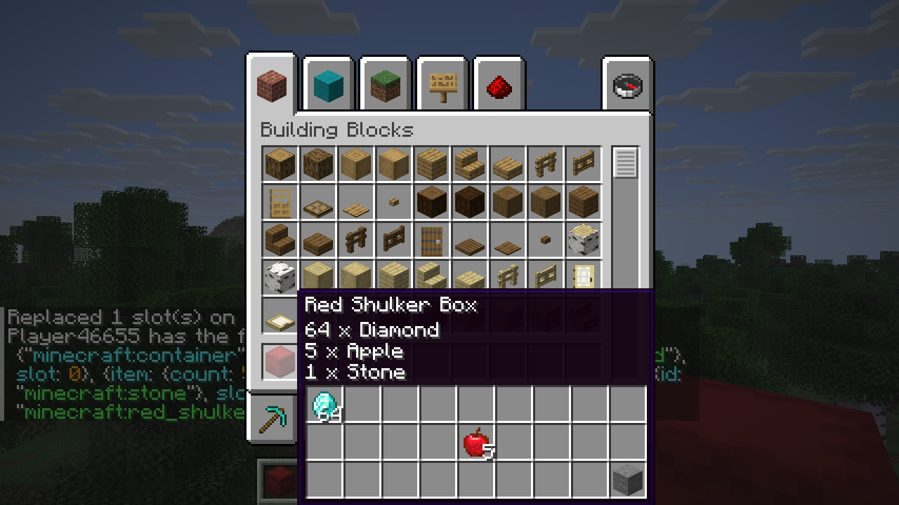
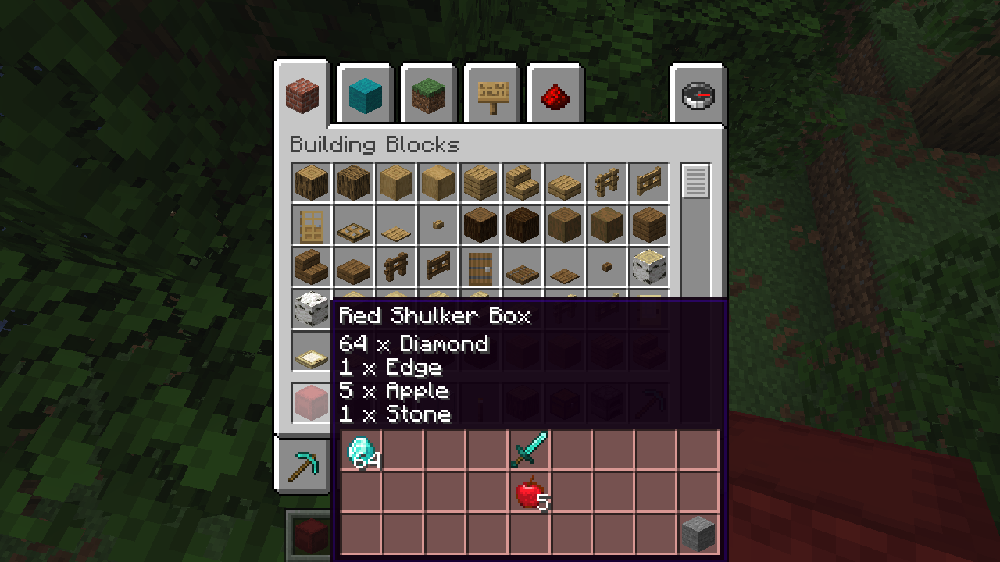

# ShulkerPeek



A native mod for [Horizon](https://github.com/horizon-rust/horizon), the Rust reimplementation of Minecraft: Java
Edition. When you hover over a shulker box, its tooltip shows the box's contents as a 9 × 3 grid of slots, under
the lines Horizon already shows. The grid has the same slot order, item models, counts and durability bars as the
box's own screen.

- Works with the plain box and all 16 dyed boxes, whether empty, partly filled or full.
- Works anywhere the game shows an item tooltip: the inventory, chests and other containers, the creative
  inventory, the item panel, chat item links, trading and the beacon.
- Keeps every line of the tooltip: the name (a custom name stays italic), vanilla's "item × count" lines, lore and
  the advanced-tooltip lines. The grid goes below them.
- Honours `minecraft:tooltip_display`. When the tooltip is hidden (`hide_tooltip`), or `minecraft:container` is
  among its hidden components, ShulkerPeek leaves the tooltip to Horizon.
- Fixes a Horizon gap so the grid works in normal play. Horizon's server leaves a shulker box's contents out of
  what it sends to its clients, and in single player the window is one of those clients. ShulkerPeek adds the
  contents back the way a vanilla server sends them, so the grid (and Horizon's own "item × count" lines)
  appear in single player and for everyone on a world you open to LAN.
- Never changes an item, an inventory or a world, and sends nothing to a server.

Not made or endorsed by the Horizon project or by Mojang.

## Compatibility

| | |
|---|---|
| Horizon | Nightly 2026-10-29, commit `5e391eb67392941734df7ddd648728c4ed5302f6` (tag `nightly-source/2026-10-29-5e391eb`) |
| horizon-mixins | `0d6b103c70633d8fd9443d8d0acd3aadaacedb06` (0.5.0, plan schema 5; the launcher's `MIXINS_REV`) |
| Minecraft | 26.3 |
| Rust | 1.99.1 (the launcher's native-mod toolchain) |

ShulkerPeek hooks a tooltip method that is **not** one of Horizon's stable native hook points, so it builds only
on the commit above. That is why its `.hnmod` has no `hooks` field. Every native mod in one build has to pin the
same commit. Horizon's official native mods (FPS Counter, Zoom, Keystrokes, Minimap, Recipes, Coordinates HUD)
use only the hook points, so the launcher builds them on ShulkerPeek's commit with no change. A third-party mod
that pins a different commit can't be built together with ShulkerPeek until one of the two is re-released.

## Install

Native mods are native code with your user's rights. Install them only from authors you trust.

- **From the registry** (once it is listed): in the Horizon launcher, open the Mods page and install
  ShulkerPeek, then click **Build**. The first native build downloads Rust and takes 20 to 30 minutes; later
  builds are faster.
- **From a file**: run `python tools/horizon.py package` (it writes `target/shulker_peek-0.1.0.hnmod`), unpack
  it, then run
  `horizon-launcher native-build path/to/unpacked --trust-native-code`.

The launcher builds a separate copy of the game for the instance, and your normal game isn't changed.

## Settings

Options → Mods → ShulkerPeek. The **ON/OFF** toggle on that row turns the mod off immediately. The next build
leaves it out. The mod's **Settings** page has three buttons:

| Button | Choices (default first) |
|---|---|
| Show contents | Always · While holding Shift |
| Empty boxes | No grid · Show the empty grid |
| Grid colour | Plain · The box's dye |



These are saved as one file per key in `horizon-mods/.horizon-mod-data/shulker_peek/` (`show`, `empty`,
`color`). The mod reads them when the game starts, and again when the Mods page lists the mods.

## How it works

Every item tooltip in Horizon goes through one method,
`horizon_client::game::stations::Game<'_>::draw_stack_tooltip`. ShulkerPeek adds a **cancellable HEAD** hook
there (`mixins/shulker_peek/tooltip.rs`):

1. If the stack isn't a shulker box, or the mod is off, it returns `Continue`. The cost is one `ends_with` and
   one set lookup.
2. It also returns `Continue` and leaves the tooltip to Horizon when any of these is true:
   - the stack's tooltip hides `minecraft:container`;
   - the stack also has bundle contents;
   - the Shift setting is on and Shift isn't held;
   - the box is empty and empty grids are off.
3. Otherwise it builds the tooltip itself, from Horizon's own pieces:
   - the lines: `stack_tooltip` and `resolved`;
   - the box and the text: `tooltip_box` and `tooltip_text`;
   - the items: `draw_item`, drawn by reference.

   The box is sized and placed as in `tooltip_geometry`, at least as wide as the grid and taller by the grid's
   height. The grid's background is the slot area (162 × 54 at (7, 17)) of `gui/container/shulker_box`, the box
   screen's own texture, so a resource pack's look carries over. Then the hook returns `Break`.

### Sending the contents (`send.rs`, `sync.rs`)

Horizon's server encodes items for its clients in `lan::guest::network_stack`. That function writes damage,
enchantments, names, bundle contents and more, but not `minecraft:container`. The client already decodes the
component (`item_sync.rs`); it just never receives it. Horizon's own tooltip lines are missing for the same
reason. The problem is still there in the newest Nightly (`a491181`).

ShulkerPeek adds a cancellable HEAD hook on `horizon_client::lan::hub::Hub::stack`, the server's encoding for
its clients. This method holds a closure, so HEAD is the only hook kind it accepts. The hook works like this:

1. For anything that isn't a shulker box with contents, it returns `Continue`, and Horizon encodes the stack as
   usual.
2. For such a box, it first calls `Hub::stack` itself (with a guard against re-entry), so the stack is exactly
   what Horizon encodes.
3. It then appends the contents in `ItemContainerContents.STREAM_CODEC` form: one optional item template per slot.
4. Finally it returns `Break`.

It sends nothing while the mod is off, and it also skips boxes whose `tooltip_display` hides their contents,
because Horizon's server doesn't send `tooltip_display` either. Tests encode boxes this way and decode them with
the client's real decoder (`item_sync::from_network`). The proper fix belongs in Horizon:
[HORIZON-ISSUE.md](HORIZON-ISSUE.md) is a ready bug report with the patch. Once Horizon fixes it, this hook can
be removed.

### Testable logic

The work that doesn't depend on the game lives in `runtime.rs`. It is plain Rust, unit-tested on its own and
inside the game's test binary. It covers slot normalization, layout, texture coordinates, dye tints and settings.
Three more HEAD hooks use the stable hook points `native_mods`, `native_settings` and `native_settings_click` for
the Options → Mods row and the settings page.

### Why a cancellable HEAD hook

The tooltip box has to be wider and taller to hold the grid, and its size is computed inside
`draw_stack_tooltip` → `tooltip_geometry`. The pinned horizon-mixins planner rejects every hook kind that could
change that from the inside (AFTER_CALL, RETURN, MODIFY_CONSTANT and similar) with `E_UNSUPPORTED_CONTROL_FLOW`,
because both methods contain closures. This was checked against the real export; see VALIDATION.md. HEAD is the
only kind those methods accept.

To keep the cancellation narrow:

- It breaks only for a shulker box it actually draws. Every other stack runs Horizon's own method unchanged.
- The hook has priority −1000, so every other mod's HEAD hook on this method (default priority 100) runs before
  it, even for shulker boxes. `tools/test_combined.py` checks this order.
- When it breaks, it skips only the rest of Horizon's body for that frame. The body is the lines, box, text and
  bundle drawing, all of which ShulkerPeek reproduces with the same functions.

### Edge cases

- **Slot data.** Slots are placed the way vanilla fills a box (`ItemContainerContents.fromSlots`, then
  `copyInto`): a later entry for a slot replaces an earlier one. Slots outside 0–26 and empty stacks show
  nothing. At most 256 entries are read, which is vanilla's codec limit.
- **Screen edges.** The box flips left of the cursor near the right edge and moves up from the bottom edge.
  Tests cover GUI scales 1 to 4 on a 1920 × 1080 window and the minimum 320 × 240 GUI.
- **Resource packs.** A pack with a larger texture maps the same slots, because texture coordinates are fractions
  of the texture. If a pack has no `gui/container/shulker_box`, the grid uses plain slot squares instead.
- **Multiplayer.** A client knows a box's contents only if its server sends the `minecraft:container`
  component:
  - **Single player and a LAN world you host:** your game is the server, so ShulkerPeek sends it. Guests see
    the grid too if they have the mod.
  - **Vanilla Java servers:** they send it, so the grid works.
  - **Another Horizon server without ShulkerPeek:** it doesn't send it. The box looks empty, as it does in
    Horizon's own tooltip, and no grid is shown unless "Show the empty grid" is on.

  The mod never asks a server for anything.

## Performance

- **Any item that isn't a shulker box:** one string-suffix check, then Horizon's own method.
- **A shulker box ShulkerPeek draws:** one 27-slot normalization with no allocation, one layout, one sprite and
  up to 27 `draw_item` calls. Nothing is cloned. NBT isn't decoded on this path, because Horizon decodes the
  container component when the item arrives. Settings come from an atomic, not from a file.
- **Compared with Horizon's own body:** the mod skips the bundle-layout probe and does the same
  `stack_tooltip` work.
- **Measured** (`cargo test --release -- --ignored --nocapture`): about 18.5 ns per frame for the mod's own
  normalization, layout and slot walk on a full box, on an i7-14650HX. That excludes the drawing calls the game
  makes anyway.
- **Idle cost:** none. There is no per-tick or per-frame hook, and nothing runs in the background.

## Develop and verify

Requirements:

- Rust through rustup: `rust-toolchain.toml` selects 1.99.1, and horizon-mixins selects its own 1.95.0.
- Python 3.11 or later.
- Git.
- A C compiler for Horizon's dependencies.
- On Linux, also `libasound2-dev`, `libudev-dev` and `pkg-config`.

Linux, macOS and Windows all work. The `--horizon` clone is only read, through `git archive` of the pinned
commit, and is never checked out.

```sh
git clone https://github.com/horizon-rust/horizon ../horizon
git clone https://github.com/horizon-rust/horizon-mixins ../horizon-mixins
git -C ../horizon-mixins checkout 0d6b103c70633d8fd9443d8d0acd3aadaacedb06
git clone https://github.com/horizon-rust/horizon-mods ../horizon-mods   # only for test_combined

cargo fmt --all --check
rustfmt --edition 2024 --check mixins/shulker_peek/*.rs tests/*/*/*.rs
cargo clippy --workspace --all-targets --locked -- -D warnings
cargo test --workspace --locked
python tools/test_stage.py    --horizon ../horizon      # stage twice, AST audit, clone unchanged
python tools/horizon.py check --horizon ../horizon      # cargo check the real horizon-client
python tools/horizon.py test  --horizon ../horizon --with tests/native   # runtime + parity tests in the game
python tools/horizon.py build --horizon ../horizon      # fast profile: horizon-client + horizon-ctl
python tools/test_combined.py --horizon ../horizon --official ../horizon-mods/native
python tools/horizon.py package                         # target/shulker_peek-0.1.0.hnmod
```

Everything generated goes under `target/`. Use `--target-dir` to share a Cargo target directory between runs.

### In-game check

This needs prepared Minecraft 26.3 resources from your own game. Don't use your real game folder: give the game
fresh temporary `HORIZON_HOME`, `HORIZON_LAUNCHER_HOME`, `XDG_DATA_HOME` and `XDG_CONFIG_HOME` folders. Then:

1. Launch with `horizon-ctl launch --world Proof --creative --offscreen --wait --resources PATH`.
2. Run
   `horizon-ctl command 'give @s minecraft:red_shulker_box[minecraft:container=[{slot:0,item:{id:"minecraft:diamond",count:64}},{slot:13,item:{id:"minecraft:apple",count:5}},{slot:26,item:{id:"minecraft:stone"}}]]'`.
3. Run `horizon-ctl open-inventory`.
4. Hover over the box. `drag-at` from outside the window to the slot's centre (from `horizon-ctl screen`)
   leaves the cursor there.
5. Run `horizon-ctl screenshot shot.png`.

## Layout

```text
mixins/shulker_peek/      the bundle (all of the .hnmod but its manifest)
  horizon-mixin.toml      pin, 2 support modules, 5 HEAD injections
  runtime.rs              shared, tested logic: the Cargo library and crate::game::shulker_peek
  tooltip.rs              the tooltip hook (cancellable HEAD)
  send.rs sync.rs         the server sends a box's contents to its clients (cancellable HEAD, lib module)
  list.rs settings.rs click.rs   Options → Mods row and settings page (native hook points)
compatibility.json        exact revisions and the SHA-256 of each Horizon file the bundle changes
tools/horizon.py          export → plan → apply → check/test/build, and package
tools/test_stage.py       determinism, unchanged clone, AST audit (tools/audit)
tools/test_combined.py    with the official native mods and tests/compat/tooltip_probe
tests/native/             test-only bundle: layout vs Horizon's tooltip_geometry, slots vs its decoder
```

## License and attribution

MIT ([LICENSE](LICENSE)). The staging and audit tooling is adapted from the MIT-licensed
[horizon-native-mod-template](https://github.com/horizon-rust/horizon-native-mod-template), which is derived from
Horizon Veinminer. The `.hnmod` packaging follows the registry's own `native/tools/native.py`. This repository has
no Minecraft assets, game binaries or exported Horizon source. The grid uses the player's own resources at run
time.
