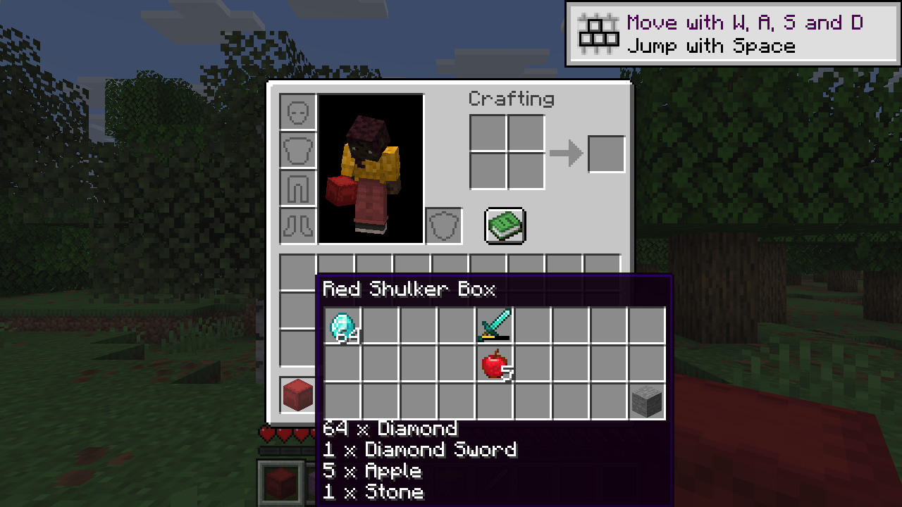
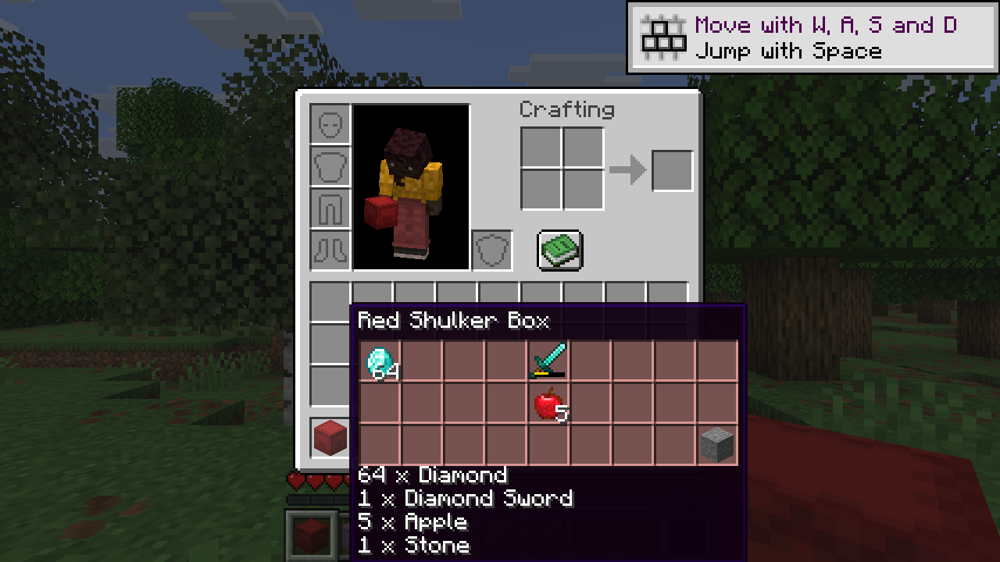

# ShulkerPeek



A mod for [Horizon](https://github.com/horizon-rust/horizon), the Rust reimplementation of Minecraft: Java Edition.
Hover a shulker box and its tooltip shows what is inside as a 9 × 3 grid, with item models, counts and durability bars.

Since 0.2.0 it is a sandboxed WebAssembly mod (`.hmod`): no native build and no Rust needed to play. The port is by
[MolaxOffi](https://github.com/MolaxOffi/ShulkerPeek-Extended).

- The plain box and all 16 dyed ones.
- The grid sits under the name. The game's other lines (item counts, lore) stay below it.
- No Shift needed, unless you choose that in the settings.
- Respects `minecraft:tooltip_display`: a hidden tooltip, or a hidden `minecraft:container`, shows no grid.
- Takes the slots' look from the game's own shulker box texture.
- Client-side. It changes no item, inventory or world, and sends nothing to a server.

Not made or endorsed by the Horizon project or by Mojang.

## Install

- **From the registry** (once 0.2.0 is listed): install ShulkerPeek from the launcher's Mods page.
- **From a file**: put `shulker_peek-0.2.0.hmod` from the [releases](https://github.com/vstxx/shulkerpeek/releases)
  into the instance's `horizon-mods/` folder and turn it on in Mods.

## Compatibility

Built with the SDK of Nightly 2026-11-21 (`f037744`). Tested in game on Nightly 2026-11-22 (`2b77287`), on Windows.

A box's contents show only where the server sends them. Current Horizon does that itself, as vanilla servers do.

## Settings

Options → Mods → ShulkerPeek → Config.

| Setting | Choices (default first) |
|---|---|
| ShulkerPeek | On · Off |
| Show contents | Always · While holding Shift |
| Empty boxes | No grid · Show the empty grid |
| Grid colour | Plain · The box's dye |



**Coming from 0.1.0:** Show contents, Empty boxes and Grid colour return to their defaults once, because Horizon's
settings API stores choices differently.

## Build

The mod is in [`wasm/`](wasm). It needs Rust 1.99.1 through rustup and Horizon's mod tool:

```sh
cargo install --locked --git https://github.com/horizon-rust/horizon --rev f037744a79f9982c47876f49c5a3067279f88706 cargo-horizon-mod
cd wasm
cargo horizon-mod build --wasm    # target/horizon-mod/shulker_peek.hmod
cargo test --locked
cargo clippy --locked --all-targets -- -D warnings
```

What was tested is in [wasm/VALIDATION.md](wasm/VALIDATION.md). The rest of this repository is the archived native
0.1 mod, described in [docs/native-0.1.md](docs/native-0.1.md).

## License and credits

MIT ([LICENSE](LICENSE), [wasm/LICENSE](wasm/LICENSE)). ShulkerPeek is by vstxx. The WebAssembly port is
Copyright (c) 2026 MolaxOffi, imported from
[ShulkerPeek-Extended](https://github.com/MolaxOffi/ShulkerPeek-Extended) at `4166b52`.
