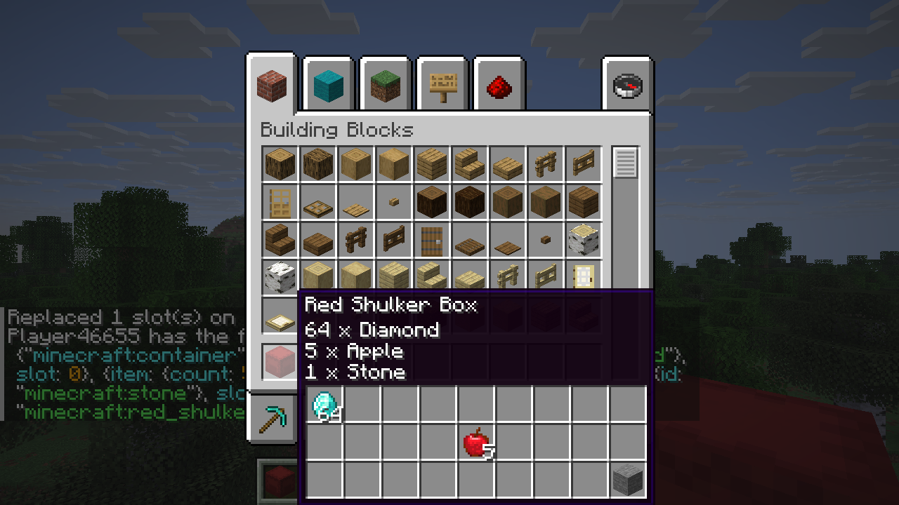
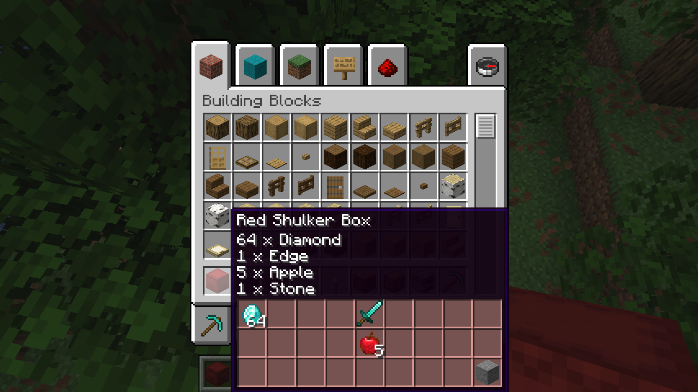

# ShulkerPeek



A native mod for [Horizon](https://github.com/horizon-rust/horizon), the Rust reimplementation of Minecraft: Java
Edition. When you hover over a shulker box, its tooltip shows the box's contents as a 9 × 3 grid of slots, under
the lines Horizon already shows. The grid has the same slot order, item models, counts and durability bars as the
box's own screen.

- Works with the plain box and all 16 dyed boxes, whether empty, partly filled or full.
- Works anywhere the game shows an item tooltip: the inventory, chests and other containers, the creative
  inventory, the item panel, chat item links, trading and the beacon.
- Keeps every line of the tooltip: the name (a custom name stays italic), vanilla's "item × count" lines, lore and
  the advanced-tooltip lines. The grid goes below them.
- Honours `minecraft:tooltip_display`. When the tooltip is hidden (`hide_tooltip`), or `minecraft:container` is
  among its hidden components, ShulkerPeek leaves the tooltip to Horizon.
- Built only on Horizon's stable native hook points, so the launcher builds it on any Horizon whose hook API is at
  least the one it needs, with no re-release for each Nightly.
- Never changes an item, an inventory or a world, and sends nothing to a server.

Not made or endorsed by the Horizon project or by Mojang.

## Compatibility

| | |
|---|---|
| Horizon | hook API 313 or later (`"hooks": 313`); tested on Nightly 2026-11-05, commit `f319701e8c9ab657ff562250b3ba07b2d654e3bc` (tag `nightly-source/2026-11-05-f319701`) |
| horizon-mixins | `e8cd0aa38cffef49cb2e088ef716baa107148c02` (plan schema 6; the launcher's `MIXINS_REV`) |
| Minecraft | 26.3 |
| Rust | 1.99.1 (the launcher's native-mod toolchain) |

ShulkerPeek hooks only Horizon's native hook points (`native_tooltip_component`, `native_tooltip_component_draw`,
`native_key` and the Options → Mods ones), which Horizon keeps stable across releases. Its `.hnmod` names the hook
API it needs (`"hooks": 313`, for `native_item_stack`) instead of pinning a commit, so the launcher builds it on the
Horizon you play, together with Horizon's official native mods and any other mod; the commit above is only the one
it was tested on.

## Install

Native mods are native code with your user's rights. Install them only from authors you trust.

- **From the registry** (once it is listed): in the Horizon launcher, open the Mods page and install
  ShulkerPeek, then click **Build**. The first native build downloads Rust and takes 20 to 30 minutes; later
  builds are faster.
- **From a file**: run `python tools/horizon.py package` (it writes `target/shulker_peek-0.1.1.hnmod`), unpack
  it, then run
  `horizon-launcher native-build path/to/unpacked --trust-native-code`.

The launcher builds a separate copy of the game for the instance, and your normal game isn't changed.

## Settings

Options → Mods → ShulkerPeek. The **ON/OFF** toggle on that row turns the mod off immediately. The next build
leaves it out. The mod's **Settings** page has three buttons:

| Button | Choices (default first) |
|---|---|
| Show contents | Always · While holding Shift |
| Empty boxes | No grid · Show the empty grid |
| Grid colour | Plain · The box's dye |



These are saved as one file per key in `horizon-mods/.horizon-mod-data/shulker_peek/` (`show`, `empty`,
`color`). The mod reads them when the game starts, and again when the Mods page lists the mods.

## How it works

Horizon's item tooltips have a hook point for an image under the lines (vanilla's `ClientTooltipComponent`, as
bundles use): `native_tooltip_component` asks for its size, and Horizon lays the tooltip out with room for it
(`tooltip_geometry`, kept on screen), draws the box and the lines, then calls `native_tooltip_component_draw` with
the corner to draw at. ShulkerPeek answers both:

1. `component.rs` reserves 162 × 54 for a shulker box whose contents show. It answers last (priority −1000) and
   keeps a component another mod already set.
2. `draw.rs` draws the grid there: the slot area (162 × 54 at (7, 17)) of `gui/container/shulker_box`, the box
   screen's own texture, so a resource pack's look carries over (tinted with a dyed box's colour when the setting
   asks), then each item with `native_item_stack` and its count with `native_text`, as a slot draws them.

Both ask `peek.rs` the same question, so they always agree. A box keeps Horizon's own tooltip when any of these
is true:

- the mod is off;
- the stack's tooltip hides `minecraft:container`;
- the stack also has bundle contents;
- the Shift setting is on and Shift isn't held (`key.rs` follows Shift through the `native_key` hook point);
- the box is empty and empty grids are off.

Horizon's server sends a box's contents to its clients itself since Nightly 2026-11-05, so the grid and Horizon's
own "item × count" lines show in single player and on LAN with nothing more from the mod.

### Testable logic

The work that doesn't depend on the game lives in `runtime.rs`. It is plain Rust, unit-tested on its own and
inside the game's test binary. It covers slot normalization, texture coordinates, dye tints, Shift and settings.
Three more HEAD hooks use the hook points `native_mods`, `native_settings` and `native_settings_click` for the
Options → Mods row and the settings page.

### Edge cases

- **Slot data.** Slots are placed the way vanilla fills a box (`ItemContainerContents.fromSlots`, then
  `copyInto`): a later entry for a slot replaces an earlier one. Slots outside 0–26 and empty stacks show
  nothing. At most 256 entries are read, which is vanilla's codec limit.
- **Screen edges.** Horizon places the tooltip, grid included, as it places every tooltip: left of the cursor near
  the right edge and up from the bottom edge.
- **Resource packs.** A pack with a larger texture maps the same slots, because texture coordinates are fractions
  of the texture. If a pack has no `gui/container/shulker_box`, the grid uses plain slot squares instead.
- **Multiplayer.** A client knows a box's contents only if its server sends the `minecraft:container`
  component:
  - **Single player and a LAN world you host:** Horizon's own server sends it. Guests see the grid too if they
    have the mod.
  - **Vanilla Java servers:** they send it, so the grid works.
  - **A Horizon server older than Nightly 2026-11-05:** it doesn't send it. The box looks empty, as it does in
    Horizon's own tooltip, and no grid is shown unless "Show the empty grid" is on.

  The mod never asks a server for anything.

## Performance

- **Any item that isn't a shulker box:** one string-suffix check in each tooltip hook, and nothing else.
- **A shulker box ShulkerPeek draws:** one 27-slot normalization with no allocation in each of the two hooks, one
  sprite and up to 27 `native_item_stack` calls. Nothing is cloned. NBT isn't decoded on this path, because Horizon
  decodes the container component when the item arrives. Settings and Shift come from atomics, not from a file.
- **Measured** (`cargo test --release -- --ignored --nocapture`): about 21 ns per hook per frame for the
  normalization and slot walk on a full box, on an i9-11900. That excludes the drawing calls the game makes
  anyway.
- **Idle cost:** a string comparison per key press for Shift; nothing per tick or per frame, and nothing in the
  background.

## Develop and verify

Requirements:

- Rust through rustup: `rust-toolchain.toml` selects 1.99.1, and horizon-mixins selects its own 1.95.0.
- Python 3.11 or later.
- Git.
- A C compiler for Horizon's dependencies.
- On Linux, also `libasound2-dev`, `libudev-dev` and `pkg-config`.

Linux, macOS and Windows all work. The `--horizon` clone is only read, through `git archive` of the pinned
commit, and is never checked out.

```sh
git clone https://github.com/horizon-rust/horizon ../horizon
git clone https://github.com/horizon-rust/horizon-mixins ../horizon-mixins
git -C ../horizon-mixins checkout e8cd0aa38cffef49cb2e088ef716baa107148c02
git clone https://github.com/horizon-rust/horizon-mods ../horizon-mods   # only for test_combined

cargo fmt --all --check
rustfmt --edition 2024 --check mixins/shulker_peek/*.rs tests/*/*/*.rs
cargo clippy --workspace --all-targets --locked -- -D warnings
cargo test --workspace --locked
python tools/test_stage.py    --horizon ../horizon      # stage twice, AST audit, clone unchanged
python tools/horizon.py check --horizon ../horizon      # cargo check the real horizon-client
python tools/horizon.py test  --horizon ../horizon --with tests/native   # runtime + parity tests in the game
python tools/horizon.py build --horizon ../horizon      # fast profile: horizon-client + horizon-ctl
python tools/test_combined.py --horizon ../horizon --official ../horizon-mods/native
python tools/horizon.py package                         # target/shulker_peek-0.1.1.hnmod
```

Everything generated goes under `target/`. Use `--target-dir` to share a Cargo target directory between runs.

### In-game check

This needs prepared Minecraft 26.3 resources from your own game. Don't use your real game folder: give the game
fresh temporary `HORIZON_HOME`, `HORIZON_LAUNCHER_HOME`, `XDG_DATA_HOME` and `XDG_CONFIG_HOME` folders. Then:

1. Launch with `horizon-ctl launch --world Proof --creative --offscreen --wait --resources PATH`.
2. Run
   `horizon-ctl command 'give @s minecraft:red_shulker_box[minecraft:container=[{slot:0,item:{id:"minecraft:diamond",count:64}},{slot:13,item:{id:"minecraft:apple",count:5}},{slot:26,item:{id:"minecraft:stone"}}]]'`.
3. Run `horizon-ctl open-inventory`.
4. Hover over the box. In survival, `click-at` the slot's centre (from `horizon-ctl ui`), wait a second so it
   isn't a double click, and `click-at` it again: the box goes back and the cursor stays over it.
5. Run `horizon-ctl screenshot shot.png`.

## Layout

```text
mixins/shulker_peek/      the bundle (all of the .hnmod but its manifest)
  horizon-mixin.toml      2 modules, 6 HEAD injections, all on native hook points
  runtime.rs              shared, tested logic: the Cargo library and crate::game::shulker_peek
  peek.rs                 whether a stack's tooltip shows the grid (crate::game::shulker_peek_game)
  component.rs draw.rs    the tooltip component: its size, then the grid (native_tooltip_component[_draw])
  key.rs                  Shift for the "while holding Shift" setting (native_key)
  list.rs settings.rs click.rs   Options → Mods row and settings page (native hook points)
compatibility.json        the hook API it needs, the tested revisions and the SHA-256 of the Horizon files it reads
tools/horizon.py          export → plan → apply → check/test/build, and package
tools/test_stage.py       determinism, unchanged clone, hook points only, AST audit (tools/audit)
tools/test_combined.py    with the official native mods and tests/compat/tooltip_probe
tests/native/             test-only bundle: slots and visibility vs Horizon's decoder
```

## License and attribution

MIT ([LICENSE](LICENSE)). The staging and audit tooling is adapted from the MIT-licensed
[horizon-native-mod-template](https://github.com/horizon-rust/horizon-native-mod-template), which is derived from
Horizon Veinminer. The `.hnmod` packaging follows the registry's own `native/tools/native.py`. This repository has
no Minecraft assets, game binaries or exported Horizon source. The grid uses the player's own resources at run
time.
